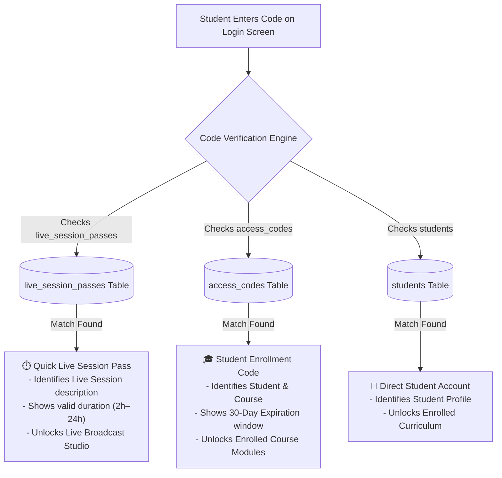

# Greach Impact Academy — Concept Dictionary & Universal Architecture

This Concept Dictionary defines the canonical data architecture, universal entity ID conventions, database schema separation, and UI feedback standards for the Greach Impact web application, Admin console, and Online Classroom.

---

## 1. Universal Entity ID Taxonomy

Every resource created, updated, or tracked across the website and Supabase database must adhere to a standardized, deterministic ID schema.

| Entity Type | ID Prefix | Canonical Pattern | Example ID | Primary Purpose |
| :--- | :--- | :--- | :--- | :--- |
| **Course** | `CRS-` | `CRS-{TOPIC}-{LEVEL}` | `CRS-EXC-BEG` | Unique identifier for academic offerings |
| **Student** | `STU-` | `STU-{YEAR}-{SEQ}` | `STU-2026-0001` | Official registered student record |
| **Enrollment Access Code** | `COD-` | `COD-{COURSE_SHORT}-{NUM}` | `COD-BEG-4912` | 30-day full course access credentials |
| **Live Session Pass** | `PAS-` | `PAS-SESS-{NUM}` | `PAS-SESS-9451` | Temporary 2h–24h live class / workshop pass |
| **Cohort / Batch** | `COH-` | `COH-{YEAR}-B{NUM}` | `COH-2026-B2` | Training cohort group (e.g. Batch 2) |
| **Order / Registration** | `ORD-` | `ORD-{YEAR}-{NUM}` | `ORD-2026-8491` | Student payment intent & verified transaction |
| **Blog Post** | `BLG-` | `BLG-POST-{NUM}` | `BLG-POST-01` | Public technical article / career guide |
| **Certificate** | `CRT-` | `CRT-{COURSE}-{YEAR}-{SERIAL}`| `CRT-EXC-2026-X892` | Accredited verifiable completion credential |
| **Live Presence Session** | `PRS-` | `PRS-{TIMESTAMP}-{HASH}` | `PRS-1792750000-8A1` | Real-time student online heartbeat |
| **Administrator** | `ADM-` | `ADM-{ROLE}-{USERNAME}` | `ADM-SUPER-GREACH` | Console administrative role & access level |

---

## 2. Canonical Course Registry & Deduplication Map

To eliminate redundant and conflicting cards in the Admin console, the course curriculum is strictly mapped to **6 canonical courses**.

> [!IMPORTANT]
> **Deduplication Resolution**: Previously, `dashboard` and `excel_dashboard` existed simultaneously, causing *"Excel Dashboard for Beginners"* to display twice. Similarly, `sql` vs `sql_beginners` and `complete_course` vs `complete_package` caused dual listings. All aliases are now collapsed into the single authoritative IDs below.

| Course ID | Course Key | Canonical Title | Original Price | Promo Price | Discount | Weekly Schedule (WAT) | Module Scope |
| :--- | :--- | :--- | :--- | :--- | :--- | :--- | :--- |
| `CRS-EXC-BEG` | `excel_beginners` | **Microsoft Excel for Beginners** | ₦15,000 | ₦3,000 | 80% OFF | Fri & Sat: 10:00 AM – 12:30 PM | Modules 1–3 (Formulas, Formatting, Tables) |
| `CRS-EXC-ADV` | `excel_advanced` | **Microsoft Excel Advanced & Analytics** | ₦20,000 | ₦4,000 | 80% OFF | Fri & Sat: 02:00 PM – 04:30 PM | Modules 4–6 (XLOOKUP, Power Query, Macros) |
| `CRS-EXC-DASH` | `excel_dashboard` | **Excel Dashboard for Beginners** | ₦80,000 | ₦40,000 | 50% OFF | Mon & Tue: 11:00 AM – 02:00 PM | Module 6 (KPIs, Slicers, Executive Visuals) |
| `CRS-SQL-BEG` | `sql` | **SQL for Beginners & Analytics** | ₦25,000 | ₦5,000 | 80% OFF | Mon & Wed: 07:00 PM – 09:00 PM | Relational Queries, Joins, Aggregations |
| `CRS-PBI-BEG` | `power_bi` | **Power BI for Beginners** | ₦45,000 | ₦22,500 | 50% OFF | Tue & Thu: 07:00 PM – 09:00 PM | Data Modeling, DAX, Interactive Reports |
| `CRS-DAT-SUITE` | `complete_course` | **Complete Analytics Suite (Full Package)** | ₦60,000 | ₦10,000 | 83% OFF | Sat: 10:00 AM – 04:30 PM | All 5 Disciplines + Capstone Coaching |

---

## 3. Database Architecture & Table Separation

In Supabase PostgreSQL, student course credentials and temporary session passes are split into **two distinct tables** with intelligent classroom resolution:

### Table 1: `access_codes` (Course Enrollment Access Codes)
Dedicated strictly to formal course enrollments.
- `id` (VARCHAR 50): Entity ID (e.g. `COD-BEG-4819`).
- `code` (VARCHAR 100, PK): Code entered by student (e.g. `GRC-BEG-4819`).
- `label` (VARCHAR 255): Descriptive name (e.g. `Course Access - Emmanuel Obi`).
- `course_id` (VARCHAR 100): Foreign course ID (e.g. `CRS-EXC-BEG`).
- `course_name` (VARCHAR 255): Full title.
- `cohort` (VARCHAR 100): Assigned batch (e.g. `Batch 2: 2026 Masterclass`).
- `student_id` (VARCHAR 50): Linked student ID (`STU-2026-XXXX`).
- `student_email` (VARCHAR 255): Student email.
- `access_type` (VARCHAR 50): `Full Course` or `VIP All Access`.
- `validity_days` (INTEGER): Default `30`.
- `expires_at` (TIMESTAMP): Expiration date/time (1 month post-class).
- `is_active` (BOOLEAN): Status toggle.
- `created_by` (VARCHAR 100): Administrator handle.

### Table 2: `live_session_passes` (Quick Live Session Passes)
Dedicated strictly to temporary live workshop sessions and drop-in guests.
- `id` (VARCHAR 50, PK): Entity ID (e.g. `PAS-SESS-9451`).
- `pass_code` (VARCHAR 100, UNIQUE): Code entered by student (e.g. `LIVE-SESS-945`).
- `session_label` (VARCHAR 255): Session description (e.g. `Live Masterclass - Morning Studio`).
- `course_id` (VARCHAR 100): Linked course (`CRS-EXC-BEG`).
- `course_name` (VARCHAR 255): Subject title.
- `cohort` (VARCHAR 100): Target batch.
- `duration_hours` (NUMERIC): Validity length in hours (e.g. `2`, `4`, `24`).
- `expires_at` (TIMESTAMP): Precise expiry timestamp.
- `is_active` (BOOLEAN): Revocation flag.
- `created_by` (VARCHAR 100): Administrator handle.

---

## 4. UI Interactive Feedback Standard

Every user click in the Admin portal and student classroom triggers immediate, non-blocking visual feedback:

1. **Button Execution State**:
   - The button text immediately changes to `<i class="fas fa-spinner fa-spin"></i> Processing...` and is disabled to prevent duplicate submissions.
2. **Success Feedback State**:
   - Upon API completion, the button highlights green with `<i class="fas fa-check-circle"></i> Success!` for 2 seconds.
3. **Toast Notifications**:
   - A floating status toast slides into the top-right corner with a clear message:
     - `showToast('Access code GRC-BEG-4912 saved to cloud database', 'success')`
     - `showToast('Live session pass LIVE-SESS-945 active for 2 hours', 'info')`
4. **Instant Grid Refresh**:
   - Target data tables reload directly from the Supabase REST API without requiring a manual page refresh.
